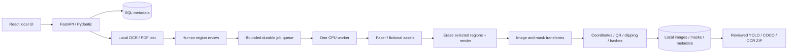
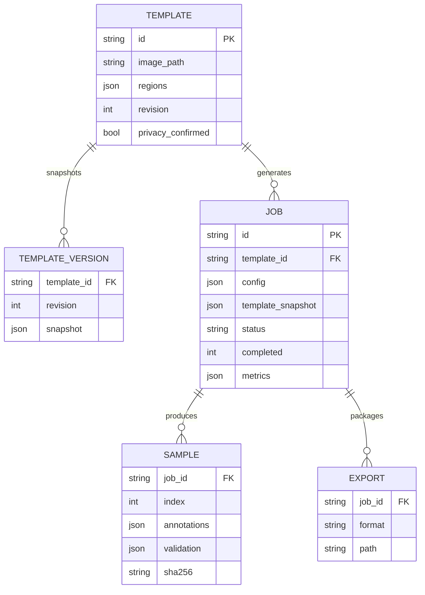

# DataForge AI — local-first implementation

**Text extension:** Synthetic text generation has now been implemented as an
additive workflow; see [text architecture, audit and endpoint contracts](text-datasets.md).
Text jobs and existing document jobs share one CPU worker and a bounded FIFO
queue, with separate SQL tables, record storage and export services. Later-phase
text/Qwen references below describe the original roadmap; this extension delivers
those text features without implementing LangGraph/RAG. Optional SD-Turbo asset previews run offline in a separate process, serialized through the shared CPU lock; see [image generation](image-generation.md).

**MCP extension:** `backend/mcp_server.py` is an optional SDK adapter with 37
typed tools and three resources over stdio/Streamable HTTP. It calls the existing
loopback API and does not start a second worker. `asset_api.py` adds standalone
rendering using the existing generators. See [MCP setup/contracts](mcp.md).

**Document rule extension:** `document_rules.py` compiles per-region prompts
to validated replace/erase/keep plans using deterministic aliases or local Qwen
under the shared CPU lock. Generation executes saved options with no per-image
LLM calls. `portraits.py` normalizes approved image pools with checksums, draws
fictional offline illustrations, and supports separate explicit downloads from
an operator-configured HTTPS image provider (off by default). The model has no
browsing tool. No template/OCR content goes to the provider. Region fields are
JSON additions; existing database tables and class IDs remain compatible.

## Scope and technology decisions

Phase 1 is a working single-page document pipeline. React/TypeScript + Vite,
Tailwind, Radix Dialog, TanStack Query, react-konva and Recharts form the UI.
FastAPI/Pydantic validate contracts; SQLAlchemy supports SQLite for the demo and
PostgreSQL for local deployment. Pillow/NumPy/OpenCV implement deterministic
rendering and annotation transforms. Faker, qrcode, python-barcode create assets.
PDFium renders PDFs (avoids PyMuPDF's AGPL/commercial licensing decision).

One persistent database queue and one worker thread are intentional on a 16 GB
CPU laptop. No Redis is required for this single-process proof of concept.
Multiple API workers are unsupported. A later separate worker service can claim
PostgreSQL jobs with SKIP LOCKED or use Redis/RQ with concurrency one.

## Repository

`backend/app/`: config, schemas, ORM, ingest/OCR, privacy, renderer, validator,
jobs, export and API. `frontend/src/`: typed API client, workflow pages, region
editor, shared components and style. `tests/`: geometry, privacy, ingestion and
100-sample HTTP integration tests. `scripts/`: Windows setup/start and benchmark.
`samples/`: fictional certificate and reproducible source. `docs/`: architecture,
model compatibility, API and implementation roadmap. `data/`: ignored runtime
storage; templates, jobs and exports. `artifacts/`: ignored test/benchmark outputs.

## Database design

Job snapshots retain confirmed field geometry, never recognized original text.
Export metadata excludes original OCR strings and source image. Template review
creates a version; changing it cannot change an existing job. POC dataset version
is its immutable job ID. A later logical Dataset entity groups job versions.

## Phase 1 implementation sequence

1. Validated schemas, bounded file ingestion, canonical page conversion.
2. Native PDF text or lazy OCR and regex PII suggestions, all requiring review.
3. Canvas region editor with manual creation, resizing, zoom/pan and type/rule.
4. Consistent seeded fictional values, opaque region masking, font fitting,
   fictional signature/seal, QR/barcode, disk-based images and instance masks.
5. Rotation of both RGB and masks; photometric blur/noise on RGB only.
6. SQL-persisted jobs, cancellation/resume, per-sample validation and metrics.
7. Gallery, quality report, export privacy acknowledgment, metadata-rich ZIP.
8. 100-sample integration test, Windows launch scripts and benchmark report.

## Geometry and annotation contract

Canonical image pixel coordinates use [x,y,width,height]. Each rendered field
has a separate binary support mask. RGB rotates with bicubic interpolation,
masks rotate with nearest-neighbor using the same center/angle. Boxes are
recomputed from transformed masks, then normalized for YOLO. Text boxes describe
rendered ink; synthetic QR boxes include the quiet zone. Label provenance is
`procedural-mask`; no model detections are advertised as exact labels. Each
sample includes transformations, value transcriptions, mask paths and class IDs.
Blur support expansion is not included in masks: masks label ideal object ink.

## Privacy and validation

All detected lines start as uncertain. Regex identifies possible emails, phones,
dates and identifier patterns; names/addresses require review. Manual regions
are always possible. Sensitive regions must be selected, confirmed and replaced.
Generation and export each enforce human privacy confirmation. Review warnings
explicitly say that undetected PII can remain. Erasure is opaque and includes
padding, with border-color restoration suitable for plain backgrounds only.
No automated proof of anonymization is claimed. Quality reports distinguish
automated checks from manual review and block rejected samples from export.

QR decode, mask alignment, bounds, finite normalized coordinates, image integrity,
field coverage, duplicate hashes and clipping are validated. Regeneration is
bounded. Original background content outside selected regions is preserved and
must be inspected. Rich background inpainting, OCR round-trip validation,
Presidio semantics and barcode decode are later work, explicitly shown as such.

## Resource policy and security boundary

Only one CPU-heavy task owns a process-wide resource lock. OCR is lazy and
released after analysis. No inference weights ship and runtime never downloads
them. Worker checks available memory before each sample, streams outputs and
records process RSS/elapsed time. RSS is sampled at sample completion; its
recorded maximum is not a continuous measurement of transient allocation peaks.
The queue holds at most eight queued/running jobs. Resume uses seed + sample
index and skips committed outputs. Startup turns interrupted running or
cancelling jobs into paused jobs, never silently reruns work.

Bind to 127.0.0.1, single Uvicorn process, allowed Host headers and exact local UI
origins. Do not expose this unauthenticated POC to a network. Uploads are capped
at 20 MB / 16 megapixels, verified by decoder, one page only; no client paths
are used. UUID disk paths prevent traversal. PostgreSQL credentials in Compose
are explicitly local development credentials. SQL schema creation is for a new
POC database; production requires Alembic migrations, authentication, retention
controls, audit logs and backup policy.

## Later phases (not claimed as implemented)

Current document analysis adds optional TrOCR-Small English crop recognition,
OCR-grounded local Qwen PII proposals and ruled-grid table extraction; see
[document-analysis.md](document-analysis.md) for implemented boundaries.

Remaining phase 2: general layout recognition, Presidio + local spaCy, structured restoration,
annotation editing/versioning, class balancing and configurable augmentations.
Phase 3: shared Qwen via loopback llama.cpp, LangGraph plan/review nodes, FAISS
local embeddings. MCP interoperability is implemented independently of those
agent components. Phase 4: opt-in SD 1.5 LCM isolated
process benchmarks at 256/512, then assets only if memory/latency acceptable.
Phase 5: text/NER with entity-first character offsets, tabular schema constraints,
relations and evaluated distributions; compositing and dataset lineage.

The proposed LangGraph state is {instruction, retrieved_rules, typed_config,
review_notes, job_id, validation_report}. Nodes: template analysis → PII
interpretation → retrieval → planning → Pydantic validation → human review →
deterministic generation → annotation validation → quality review → export
planning. Every semantic node uses one shared local model, never one per agent
or one inference per sample. Failed validation routes back to planning, bounded
by a retry limit. The implemented MCP adapter reuses FastAPI contracts and
validation rather than implementing agent planning. Its exact tool names,
configuration, native image results and export transfers are in [mcp.md](mcp.md).
